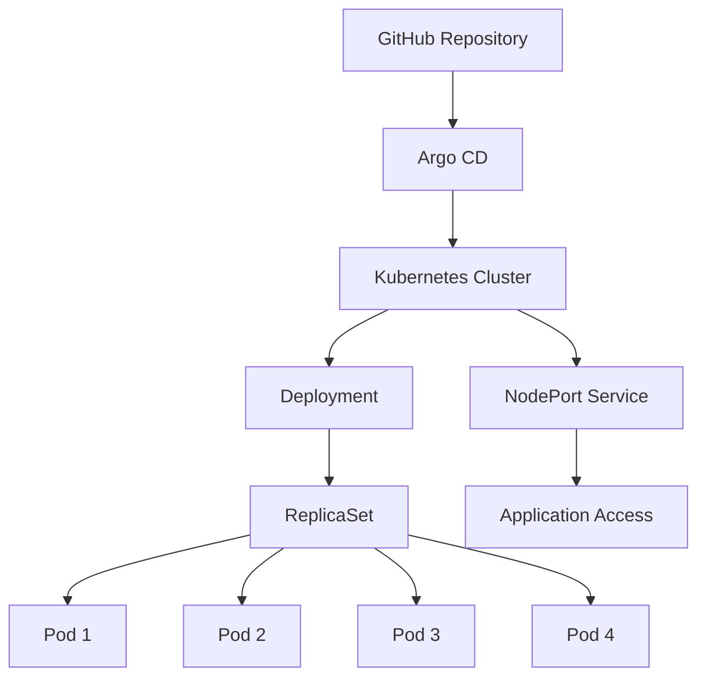

# 🚀 KubeSync-GitOps
### Kubernetes Self-Healing & GitOps Deployment with Argo CD

**Automated Kubernetes deployment, self-healing, and continuous synchronization using Argo CD.**


---

## 📌 Project Overview

**KubeSync-GitOps** is a hands-on DevOps project developed as part of my **DevOps Internship at Elevate Labs**.

The project demonstrates how Kubernetes maintains application availability through its self-healing mechanism and how Argo CD implements GitOps principles to continuously synchronize Kubernetes resources with the configurations stored in a GitHub repository.

The application is deployed using Kubernetes with four replicas. Argo CD monitors the GitHub repository and automatically synchronizes the desired configuration with the Kubernetes cluster.

The main objective was to understand how container orchestration, automated deployments, and self-healing mechanisms work together in a real-world DevOps environment.

## 🎯 Project Objectives

- Understand Kubernetes Deployments and ReplicaSets.
- Deploy and manage containerized applications.
- Implement application availability using multiple replicas.
- Demonstrate Kubernetes self-healing by deleting running pods.
- Implement GitOps using Argo CD.
- Configure automated synchronization and self-healing.
- Monitor application health and synchronization status.

## 🏗️ Architecture



### How It Works

1. Application manifests are maintained in GitHub.
2. Argo CD monitors the repository.
3. Argo CD synchronizes the desired configuration with Kubernetes.
4. Kubernetes Deployment maintains four application replicas.
5. If a pod is deleted, Kubernetes automatically creates a replacement.
6. Argo CD continuously monitors the application's synchronization and health.

## 🛠️ Technology Stack

| Technology | Purpose |
|---|---|
| Kubernetes | Container orchestration |
| Minikube | Local Kubernetes cluster |
| Argo CD | GitOps continuous delivery |
| Git & GitHub | Version control and configuration management |
| Docker | Container technology |
| NGINX Demo | Sample web application |
| YAML | Kubernetes configuration |

## 📂 Project Structure

```text
KubeSync-GitOps/
│
├── application.yaml
│
└── manifests/
    ├── deployment.yaml
    └── service.yaml
```

### Configuration Files

**1. application.yaml**

Defines the Argo CD Application resource.

- Connects to the GitHub repository.
- Uses the `manifests` directory as the deployment source.
- Enables automated synchronization.
- Enables pruning of removed resources.
- Enables self-healing.

**2. manifests/deployment.yaml**

Defines the Kubernetes Deployment.

- Application: `kubasync-app`
- Replicas: 4
- Container image: `nginxdemos/hello:plain-text`
- Container port: 80
- CPU and memory requests and limits configured.

**3. manifests/service.yaml**

Defines the Kubernetes NodePort Service.

- Service name: `kubasync-service`
- Service type: NodePort
- Service port: 80
- Target port: 80
- NodePort: 30080

## ⚙️ Implementation

### Step 1: Start Minikube

```bash
minikube start
```

Verify the Kubernetes cluster:

```bash
kubectl get nodes
```

### Step 2: Install Argo CD

Create the Argo CD namespace:

```bash
kubectl create namespace argocd
```

Install Argo CD:

```bash
kubectl apply -n argocd -f https://raw.githubusercontent.com/argoproj/argo-cd/stable/manifests/install.yaml
```

Verify the Argo CD pods:

```bash
kubectl get pods -n argocd
```

### Step 3: Configure Argo CD Application

Apply the application configuration:

```bash
kubectl apply -f application.yaml
```

Check the application status:

```bash
kubectl get applications -n argocd
```

### Step 4: Verify Deployment

Check the application pods:

```bash
kubectl get pods -l app=kubasync-app
```

Check all deployment resources:

```bash
kubectl get all
```

Check the deployment:

```bash
kubectl get deployment kubesync-app
```

### Step 5: Test Kubernetes Self-Healing

To demonstrate Kubernetes self-healing, manually delete all application pods using their label selector:

```bash
kubectl delete pod -l app=kubasync-app
```

Immediately monitor the pods:

```bash
kubectl get pods -l app=kubasync-app -w
```

**Expected Behaviour:**

- Existing pods are deleted.
- Kubernetes detects that the actual number of replicas is below the desired count.
- The ReplicaSet controller creates replacement pods.
- New pods transition to the `Running` state.
- The Deployment maintains the desired count of four replicas.

This demonstrates Kubernetes' built-in self-healing capability.

### Step 6: Verify Argo CD Synchronization

Check the Argo CD application:

```bash
kubectl get applications -n argocd
```

Expected status:

| Parameter | Status |
|---|---|
| Application | kubesync-gitops |
| Sync Status | Synced |
| Health Status | Healthy |

## 📊 Project Results

The following results were observed during implementation:

| Test | Result |
|---|---|
| Kubernetes Deployment | Successful |
| Desired Replicas | 4 |
| Pod Deletion Test | Successful |
| Automatic Pod Recreation | Successful |
| Running Pod Status | 4/4 Running |
| Pod Restarts | 0 |
| Argo CD Synchronization | Synced |
| Argo CD Health | Healthy |

**Key Achievement:** Successfully demonstrated Kubernetes automatically recreating deleted application pods while Argo CD reported the application as `Synced` and `Healthy`.

## 📸 Project Screenshots

Screenshots documenting the implementation:

1. Kubernetes pod deletion and automatic recreation.
2. Four application pods running after the self-healing test.
3. Argo CD dashboard showing the application as Healthy and Synced.

_Add your screenshots to a `screenshots/` directory and embed them here when uploaded._

```markdown


```

## 📚 Key Learnings

Through this project, I gained practical experience in:

- Kubernetes Deployments and ReplicaSets.
- Container orchestration.
- Pod lifecycle management.
- Kubernetes self-healing mechanisms.
- Desired state management.
- GitOps workflows.
- Argo CD application synchronization.
- Automated resource management.
- Monitoring Kubernetes application health.

## 🔮 Future Enhancements

Potential improvements for this project include:

- Integrating GitHub Actions for CI/CD automation.
- Implementing container image build and publishing workflows.
- Adding Prometheus and Grafana for monitoring.
- Configuring Ingress for external application access.
- Implementing resource autoscaling using HPA.
- Adding application health probes.
- Implementing automated deployment notifications.

## 👨‍💻 Author

**Muaz Pathan**

DevOps Engineer | Cloud & DevOps Enthusiast

- GitHub: [@MuazPathan](https://github.com/MuazPathan)
- LinkedIn: [Muaz Pathan](https://www.linkedin.com/in/muaz-pathan/)

## 🏢 Internship

**Developed as part of my DevOps Internship at Elevate Labs.**

This project represents my hands-on learning experience with Kubernetes, GitOps, container orchestration, and Argo CD.

---

⭐ If you find this project useful, consider giving this repository a star!

**Reflect. Build. Automate. Deploy.**